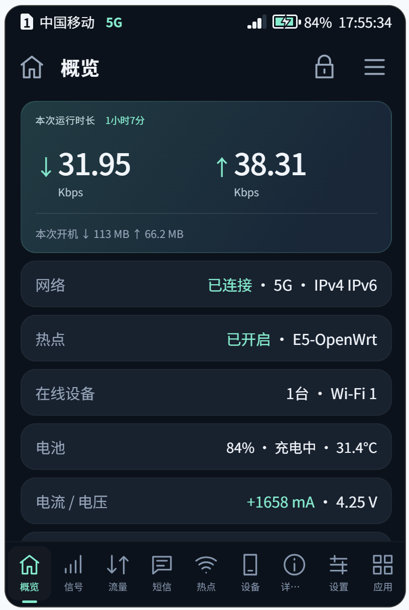

# 底部导航 · Bottom Bar

底部导航显示全部 9 个页面

*All nine pages in the bottom bar*

容悦 E5（OpenWrt）信息屏应用。当前版本 **v1.5**，应用 ID `navbar`。

## 截图

底部导航显示全部 9 个页面：概览、信号、流量、短信、热点、设备、详情、设置、应用。

## 安装

1. 下载 [`releases/navbar-v1.4.tar.gz`](releases/navbar-v1.4.tar.gz)。
2. 在信息屏的「应用管理」中安装（LuCI：服务 → 信息屏应用 → 应用管理）。
3. 安装后文件位于设备上的 `/etc/e5-infoscreen/plugins/navbar/`。

## 设置

加粗为默认值。

- 底部导航（Bottom bar）：**全部 9 个页面**；5 个（原样）

## 源码

`navbar/` 是当前版本安装包解压后的内容：

- [`backend.uc`](navbar/backend.uc)
- [`index.html`](navbar/index.html)
- [`luci/menu.json`](navbar/luci/menu.json)
- [`luci/navigation.js`](navbar/luci/navigation.js)
- [`manifest.json`](navbar/manifest.json)
- [`patch.js`](navbar/patch.js)

## 版本

- [v1.5](releases/navbar-v1.5.tar.gz)（当前）：屏幕上改「底部导航显示」后立即重排导航栏；LuCI 的「底部导航」页直接读写这个设置（9 个 / 5 个），不再依赖应用列表
- [v1.4](releases/navbar-v1.4.tar.gz)
- [v1.3](releases/navbar-v1.3.tar.gz)
- [v1.0](releases/navbar-v1.0.tar.gz)
